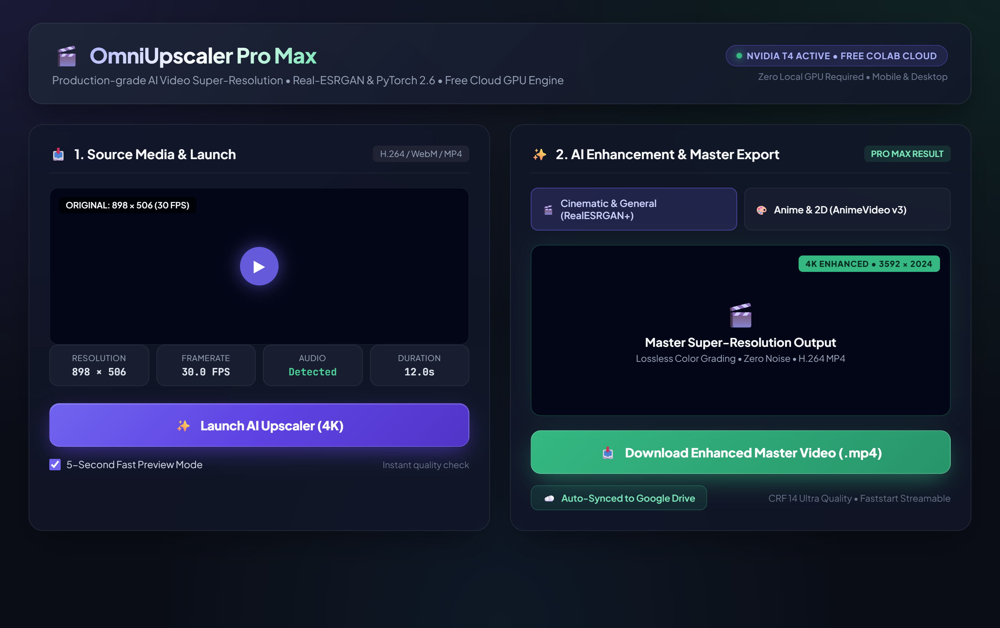

<div align="center">

# 🎬 OmniUpscaler (OmniScale AI)
### Free 4K AI Video Super-Resolution for Low-End PCs, Laptops & Mobile Phones

<br>

<a href="https://colab.research.google.com/github/NiL4gh/omni-upscaler/blob/main/enhanced_video_upscaler.ipynb" target="_blank">
  
</a>

<br><br>

<a href="https://colab.research.google.com/github/NiL4gh/omni-upscaler/blob/main/enhanced_video_upscaler.ipynb" target="_blank">
  
</a>
[](LICENSE)
[](#-why-omniupscaler)
[](https://github.com/xinntao/Real-ESRGAN)
[](#-architecture--zero-disk-streaming)

<p align="center">
  <b>No RTX 4090? No problem.</b> Upscale your videos to crisp 4K from any device in the world completely free using Google's cloud GPUs.
</p>

---



</div>

---

## ⚡ Why OmniUpscaler?

Traditional AI video software (like Topaz Video AI or local Real-ESRGAN builds) demands expensive $1,500+ dedicated desktop GPUs, 16GB+ VRAM, and causes thermal throttling on consumer laptops. Meanwhile, paid cloud websites lock downloads behind paywalls and watermarks.

**OmniUpscaler changes this:**
* **100% Free & Open Source**: No subscriptions, no credits, no watermarks.
* **Runs Anywhere**: Operates in your browser. Compatible with budget laptops, MacBooks, Chromebooks, and **smartphones (iOS & Android)**.
* **NVIDIA Cloud Acceleration**: Leverages free NVIDIA T4 GPU instances on Google Colab.
* **Zero-Disk Streaming Engine**: Custom in-memory FFmpeg pipe architecture prevents Colab storage crashes, enabling videos of arbitrary length (10, 30, 60+ minutes).
* **Modern Studio Interface**: Form-mode one-click launch with real-time media inspection, glowing one-click master download, and Google Drive auto-sync.

---

## 🚀 Quickstart (Under 60 Seconds)

### Step 1: Open in Colab
Click the large button below to launch the cloud notebook directly on Google Colab (no installation required):

<p align="left">
  <a href="https://colab.research.google.com/github/NiL4gh/omni-upscaler/blob/main/enhanced_video_upscaler.ipynb" target="_blank">
    
  </a>
</p>

### Step 2: Connect GPU Runtime
1. In Colab, make sure the runtime is set to **T4 GPU** (`Runtime` ➔ `Change runtime type` ➔ `T4 GPU`).
2. Click **Connect** in the upper-right corner.

### Step 3: Run the Studio
1. Click the **Play button ▶** on the collapsed code form.
2. In about 20–30 seconds, a public Gradio share link will appear (e.g., `https://xxxxxx.gradio.live`).
3. Click the link to open the full web studio on desktop or your phone!

---

## 📱 Using on Mobile (iPhone & Android)

You don't even need a computer to upscale your videos:

1. Open the [Colab Notebook](https://colab.research.google.com/github/NiL4gh/omni-upscaler/blob/main/enhanced_video_upscaler.ipynb) on Safari (iOS) or Chrome (Android).
2. Tap the **Play button ▶** on the cell.
3. Tap the **`https://xxxxxx.gradio.live`** public link generated in the cell output.
4. Upload any video directly from your **Photo Library / Camera Roll / Files**.
5. Tap **✨ Launch AI Upscaler**.
6. When complete, tap **📥 Download Enhanced Master Video (.mp4)** to save the 4K video straight to your phone.

> 📖 *For power tips on keeping mobile sessions active, read our [Mobile Guide](docs/MOBILE_GUIDE.md).*

---

## 🎛️ AI Presets & Models

| Preset | Target Content | AI Model | Scale | Recommended For |
| :--- | :--- | :--- | :--- | :--- |
| **Cinematic & Real-World** | Movies, drones, vlogs, nature | `RealESRGAN_x4plus` | 4K / 2K | Real-world footage with complex texture restoration |
| **Anime & 2D Animation** | Cartoons, anime, game captures | `realesr-animevideov3` | 4K / 2K | Clean lines, cartoon color gradients, zero ringing artifacts |
| **Face Restoration** | Portraits, family videos, interviews | `RealESRGAN_x4plus` + `GFPGAN v1.3` | 4K | Facial detail recovery and eye/mouth sharpening |
| **Fast 2x Polish** | Web videos, quick social media clips | `RealESRGAN_x2plus` | 2K | High-speed processing with minimal compute overhead |

---

## ⚙️ Architecture & Zero-Disk Streaming

Standard Real-ESRGAN implementations unpack **every single frame as an uncompressed PNG** onto the disk (`--extract_frame_first`). For a 5-minute 1080p video at 30 FPS, this requires over **130 GB of disk space**, crashing Google Colab's 30 GB free storage boundary with `[Errno 28] No space left on device`.

### How OmniUpscaler Solves This:
```
[Source Video] ➔ FFmpeg Stream ➔ [In-Memory Pipe] ➔ PyTorch 2.6 Tensor (GPU)
                                                               │
[Master .mp4] 🠤 FFmpeg Encode 🠤 [In-Memory Pipe] 🠤 Real-ESRGAN Neural Upscale
```

1. **In-Memory Pipe Streaming**: Frames stream directly through RAM/VRAM pipes (`FFmpeg` $\rightarrow$ GPU $\rightarrow$ `FFmpeg`). **0 PNG files** are saved to disk, cutting storage consumption by **99%**.
2. **Smart 120-Second Chunking**: Videos exceeding 3 minutes are automatically segmented into 120-second slices. Each slice is upscaled with `torch.cuda.empty_cache()` executed between chunks, and the resulting segments are losslessly joined via `ffmpeg -f concat -c copy`.
3. **PyTorch 2.6 Unpickler Patch**: Pre-patched for modern PyTorch unpickler security standards (`weights_only=False` override for legacy Real-ESRGAN `.pth` checkpoints).

> 🔬 *Deep dive technical details are available in [Architecture Documentation](docs/ARCHITECTURE.md).*

---

## 📊 Comparison

| Feature | Local Desktop Apps (Topaz, etc.) | Paid Cloud Websites | OmniUpscaler (This Repo) |
| :--- | :---: | :---: | :---: |
| **Cost** | $199–$299 | $15–$50 / month | **100% Free** |
| **Hardware Required** | RTX 3070 / 4090 ($800+) | Any browser | **Any device / browser / mobile** |
| **Watermarks** | None (if paid) | Often watermarked on free tier | **Zero watermarks** |
| **Video Length Limit** | Limited by local PC | 1–3 mins on free tier | **Unlimited (120s chunked)** |
| **Audio Preservation** | Yes | Often stripped or compressed | **Yes (Lossless AAC + Gain slider)** |
| **Cloud Auto-Save** | Manual | Cloud storage fee | **Direct Google Drive Sync** |

---

## 🤝 Contributing

Contributions, feedback, and model additions are warmly welcomed! Feel free to open an Issue or submit a Pull Request.

1. Fork the Project
2. Create your Feature Branch (`git checkout -b feature/AmazingFeature`)
3. Commit your Changes (`git commit -m 'Add some AmazingFeature'`)
4. Push to the Branch (`git push origin feature/AmazingFeature`)
5. Open a Pull Request

---

## 📜 License

Distributed under the MIT License. See [`LICENSE`](LICENSE) for more information.

---

<div align="center">
  <sub>Crafted with passion for open-source AI accessibility by <a href="https://github.com/NiL4gh">NiL4gh</a>.</sub>
</div>
